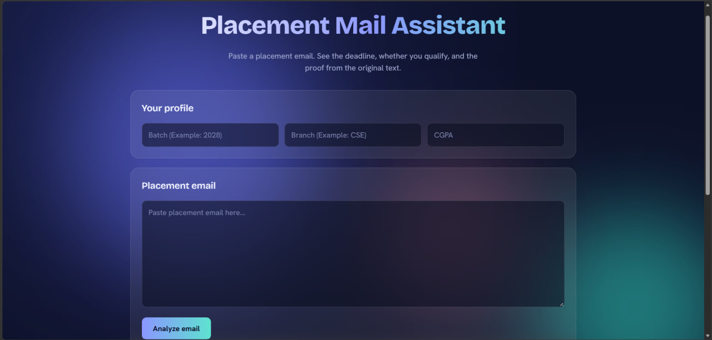
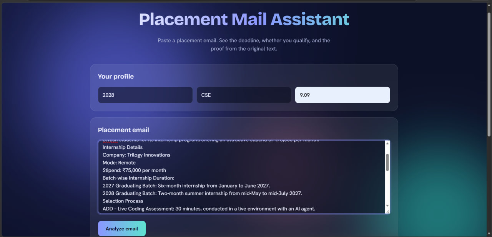
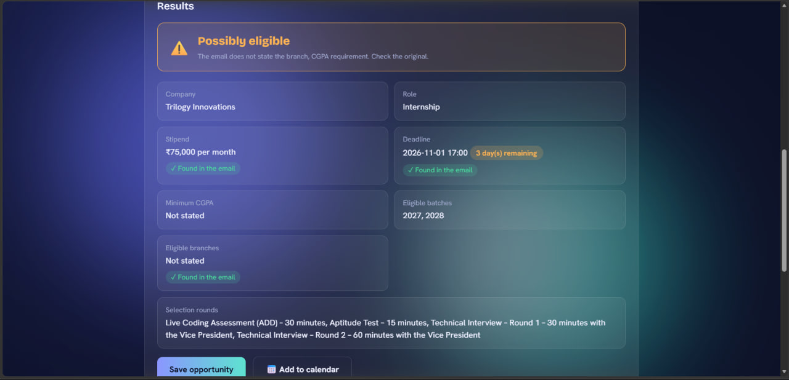
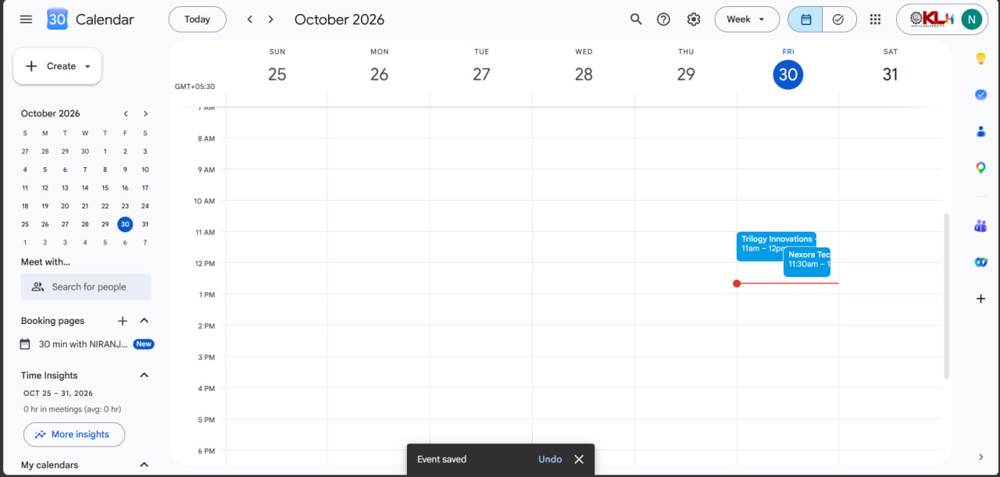

# Placement Mail Assistant

Paste a placement email and see the deadline, whether you qualify, and the exact sentence in the email that proves each fact.

**Live demo:** https://placement-mail-assistant.onrender.com
*(Hosted on a free plan. If it has been idle, the first load can take about a minute.)*



## The problem

Placement emails are long, and the details that matter (deadline, eligibility, rounds) are buried inside. Students skim and sometimes miss a deadline or misread who is eligible.

[FILL: one real sentence from a classmate about this problem, in their words, with permission.]

## What it does

- Extracts company, role, stipend, deadline, minimum CGPA, eligible batches and branches, and selection rounds
- Checks eligibility against your batch, branch and CGPA, and says "possibly eligible" when the email does not state a requirement
- Shows a deadline countdown that turns amber and then red as time runs out
- Creates a Google Calendar reminder for the deadline
- Saves opportunities in your browser, sorted by nearest deadline
- **Verifies the AI's work:** every extracted fact comes with a quoted sentence, and the server checks that the sentence really appears in the email. If it does not, the page shows "Could not verify" instead of trusting the model.

## Screenshots

| Paste an email | Results | Saved list | Calendar |
|---|---|---|---|
|  |  |  |  |

## How it works

```
Placement email -> FastAPI -> hosted LLM (Groq) -> JSON + quoted evidence
                -> server checks each quote exists in the email
                -> browser checks eligibility, countdown, calendar link
```

- **Backend:** Python, FastAPI
- **AI:** `openai/gpt-oss-120b` through Groq's OpenAI-compatible API (free tier)
- **Frontend:** HTML, CSS, JavaScript
- **Storage:** browser localStorage only. Emails are not stored on the server.

## Decisions I made

**Local model vs hosted API.** The first version ran Llama 3.2 locally with Ollama. It worked on my laptop but could not be deployed, because free hosts cannot run it and it would only work while my laptop was on. I switched to a hosted API for availability. The cost is a dependency on an outside service and its free-tier rate limits. The model, URL and key are environment variables, so I can still point it at a local model.

**Eligibility in code, not AI.** Rules should give the same answer every time, so the eligibility check is plain JavaScript. The AI only extracts the facts.

**Do not trust the model.** The model must copy an exact sentence as evidence, and the server verifies it. When information is missing, the model returns empty fields instead of guessing.

## Results

Tested on 10 placement emails.

| Check | Result |
|---|---|
| Deadline correct | [7] of [10] |
| Eligibility fields correct | [5] of [10] |
| Quote check caught a wrong or invented quote | [2] times |
| Missing information returned empty instead of invented | [2] of [4] |

Tried by 5 classmates. Main feedback: It's actually worth using as it reduces the inefficient need of reading long emails also to mention ,it has got more potential to be extended and added more features.

## Limitations

- It can misread unusual email layouts, so always confirm details in the original email.
- The free AI plan has rate limits, so many requests at once may fail temporarily.
- Deadlines are interpreted in Indian Standard Time.
- [FILL: one real problem you noticed while testing.]

## Privacy

Pasted emails are sent to the AI provider (Groq) for processing and are not stored by this app. Saved opportunities live only in your own browser.

## Run it locally

```bash
git clone https://github.com/2410030346-gif/placement-mail-assistant.git
cd placement-mail-assistant
python -m venv venv
venv\Scripts\activate
python -m pip install -r requirements.txt
```

Create a `.env` file:

```
LLM_API_KEY=your_groq_key
LLM_BASE_URL=https://api.groq.com/openai/v1
LLM_MODEL=openai/gpt-oss-120b
```

Then run `python -m uvicorn main:app --reload` and open http://127.0.0.1:8000